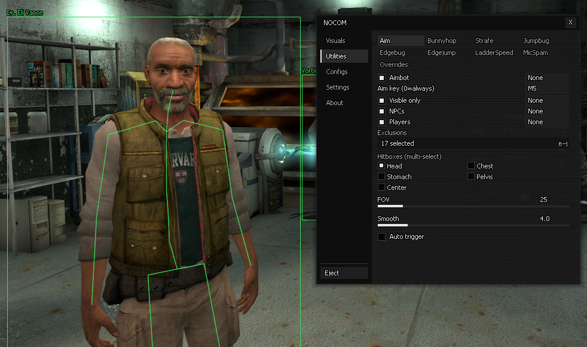
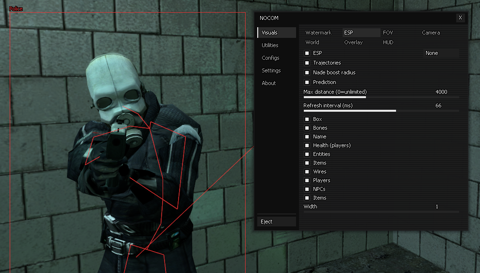
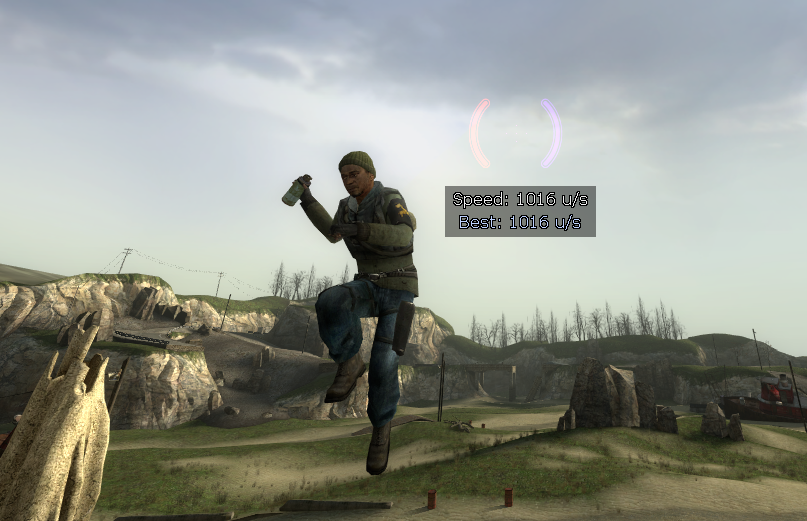
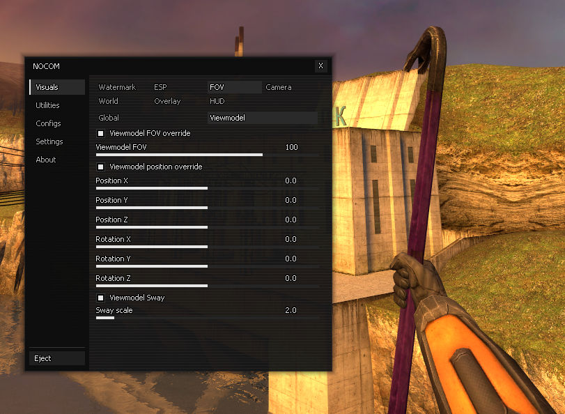

  ## 
  A C++ plugin for Synergy that provides to you various <del>cheats</del> utilities and gameplay enhances 
  Imagine cheating in a co-op game =)

---

### Utilities

  

  
<i>Player highlighting, skeleton overlays, and configurable gameplay options</i>

  
  ---

  

  
<i>yabadabada</i>

  
  ---

  

  
<i>Get your best record today!</i>

  
  ---

  

  
<i>Customize your Synergy like never before!</i>

