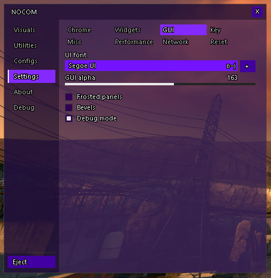

  ## 
  A C++ plugin for Synergy that provides to you various <del>cheats</del> utilities and gameplay enhances 
  Imagine cheating in a co-op game =)
    
  This uses [SylvHooker](https://github.com/sylvessa/SylvHooker) from [sylvessa](https://github.com/sylvessa) for hooking onto functions. Thanks sylvessa!

### 
Changes in this version

- **Utilities**
  - Aim
    - yabadaba
  - Bunnyhop
  - Strafe
    - Bidirectional support
  - Jumpbug
    - Untested
  - Edgebug
    - Untested
  - Edgejump
    - Bidirectional support
  - LadderSpeed
    - Horrible
  - MicSpam
  
- **Visual**
  - can someone do this for me ok thanks

---

### 
Gallery

  
  
  ---

  
  
  ---

  
  
  ---

  
  
  ---

  

